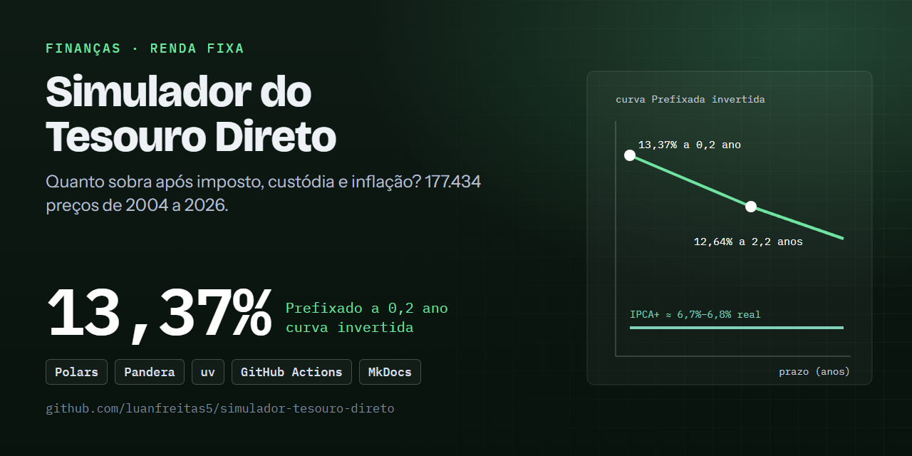

# 📈 Simulador do Tesouro Direto: quanto sobra, de fato, depois de IR, custódia e inflação

[](https://github.com/luanfreitas5/simulador-tesouro-direto/actions/workflows/ci.yml)
[](https://codecov.io/gh/luanfreitas5/simulador-tesouro-direto)
[](https://luanfreitas5.github.io/simulador-tesouro-direto/)
[](LICENSE)
 <!-- = matriz do tests.yml -->

> **Resultado:** com R$ 10.000 comprados em 15/10/2026 e mantidos até o vencimento, o
> **Tesouro Prefixado 2029 (12,64% a.a.)** rende **11,04% a.a. líquido (6,26% a.a. real)** contra
> **10,47% a.a.** do benchmark Selic, enquanto o **IPCA+ 2035 (IPCA + 6,84%)** rende **10,47% a.a.
> líquido (5,71% real)** contra **10,97%** da Selic, sob IPCA de 4,5% a.a. e Selic de 12% a.a.
> assumidos. É uma **simulação determinística**, não um modelo preditivo: não há intervalo de
> confiança, e a incerteza está nas premissas (ver [Limitações](#️-limitações)).

> ⚠️ **Projeto educacional, sem recomendação de investimento.** Alíquotas, taxas e regras mudam.
> **Confira as regras vigentes** (Tesouro Direto, B3 e Receita Federal) antes de usar qualquer
> resultado. Todos os parâmetros ficam em [configs/finance.yaml](configs/finance.yaml) e na barra
> lateral do app.



## 🎯 Problema

- **Quem decide o quê:** um investidor pessoa física escolhe entre Tesouro Prefixado, Tesouro IPCA+
  e simplesmente manter o dinheiro na Selic para uma compra em uma data D, de valor V, com
  vencimento T.
- **Custo dos erros:** taxas são divulgadas como "X% ao ano" ou "IPCA + X%", mas o que importa é o
  ganho **depois** do imposto, da custódia e da inflação. Comparar bruto com bruto superestima o
  retorno e pode inverter a escolha entre títulos. Não há "falso positivo/negativo" aqui:
  a métrica principal é a **rentabilidade líquida e real anualizada**, porque é a que o investidor
  efetivamente recebe e consegue comparar com a Selic.
- **Unidade e momento `t0`:** uma simulação por (título, vencimento, data de compra). Usa apenas a
  taxa de compra conhecida até `t0` (tolerância de 7 dias) e o IPCA/Selic observados até `t0`;
  depois do último dado publicado entram as **premissas do usuário**.
- **Pergunta complementar:** como a curva de juros (taxa × prazo) do Prefixado e do IPCA+ se
  deformou ao longo do tempo?

## 🗂️ Dados

| Item | Valor |
|---|---|
| Fonte e licença | [Tesouro Transparente](https://www.tesourotransparente.gov.br) (taxas dos títulos), [BCB SGS](https://dadosabertos.bcb.gov.br) séries 11 (Selic, % a.d.) e 433 (IPCA, % mensal) — dados abertos governamentais; conferir os termos de uso dos portais (ver Datasheets) |
| Tamanho / período | Tesouro: 177.434 linhas silver, 31/12/2004–15/10/2026 · Selic: 6.229 linhas, 02/01/2002–16/10/2026 · IPCA: 297 meses, 01/2002–09/2026 |
| Alvo e prevalência | Sem alvo supervisionado: o resultado é calculado (rentabilidade bruta, líquida e real) |
| Documentação | [Datasheet Tesouro Transparente](reports/datasheets/tesouro_transparente.md) · [Datasheet BCB SGS](reports/datasheets/bcb_sgs.md) |

Arquitetura medalhão (os dados **não** são versionados no Git):

```
data/bronze/  snapshots imutáveis, como recebidos + manifest.json (URL, SHA-256, data)
data/silver/  limpos, tipados, deduplicados e validados (Pandera): tesouro_prices, selic_daily, ipca_monthly
data/gold/    yield_curve.parquet — curva de juros pronta para o app
```

A ingestão é **idempotente** e usa **cache local**: dentro do TTL (24 h, configurável) nenhuma
requisição é feita; se o conteúdo baixado tiver o mesmo SHA-256, nenhum snapshot novo é criado; se
a rede falhar e houver snapshot, ele é reutilizado com um aviso. A URL do CSV é configurável em
[configs/config.yaml](configs/config.yaml) caso o portal mude o endereço do recurso.

## 📊 Resultados

Protocolo: execução do pipeline (`make data train`) em 17/10/2026, `seed` 42; **sem IC**, pois o
cálculo é determinístico dado o conjunto de premissas. A comparação é com o **benchmark Selic**
(mesmo valor, prazo, IR e custódia), o equivalente à alternativa de "não escolher título".

### Execução do pipeline

| Camada | Artefato | Registros | Período |
|---|---|---:|---|
| Silver | `tesouro_prices.parquet` | 177.434 | 31/12/2004 a 15/10/2026 |
| Silver | `selic_daily.parquet` | 6.229 | 02/01/2002 a 16/10/2026 |
| Silver | `ipca_monthly.parquet` | 297 | 01/2002 a 09/2026 |
| Gold | `yield_curve.parquet` | 47.157 (28.215 Prefixado; 18.942 IPCA+) | 31/12/2004 a 15/10/2026 |

Todos os contratos de dados (`pandera`) passaram e os dois gráficos HTML foram gerados em
[`reports/figures/`](reports/figures/). A execução completa, com os dados em cache, levou cerca de 5 s.

### Simulações de exemplo vs. benchmark Selic

R$ 10.000 comprados em 15/10/2026 e mantidos até o vencimento, com IR regressivo e custódia de
0,20% a.a. Para o trecho sem dado observado, assume-se IPCA de 4,5% a.a. e Selic de 12% a.a.
(premissas do usuário, **não** previsões).

| Título | Líquido final | Líquido a.a. | Real a.a. | Benchmark Selic (líquido a.a.) |
|---|---:|---:|---:|---:|
| Prefixado 2029 (12,64%) | R$ 12.611,67 | **11,04%** | 6,26% | 10,47% |
| IPCA+ 2035 (IPCA + 6,84%) | R$ 23.511,07 | **10,47%** | 5,71% | 10,97% |

- Diferença vs. benchmark: Prefixado 2029 **+0,57 p.p.** a.a.; IPCA+ 2035 **−0,50 p.p.** a.a.
  Não há teste de significância: a conclusão é uma identidade aritmética das premissas e **muda se
  elas mudarem** (o Prefixado trava 12,64%; o IPCA+ perde para uma Selic de 12% contra IPCA de 4,5%,
  que implica juro real alto).
- Pior cenário: o IPCA+ 2035 perde para a Selic assumida; sensibilidade a IPCA e Selic futuros é
  a principal fonte de incerteza (ver [Model Card](reports/model_cards/simulador_rentabilidade_v0.1.0.md)).

### Curva de juros na última data (15/10/2026)

| Título | Vencimento | Prazo (anos) | Taxa de compra (% a.a.) |
|---|---|---:|---:|
| Prefixado | 01/01/2027 | 0,2 | 13,37 |
| Prefixado | 01/01/2028 | 1,2 | 12,77 |
| Prefixado | 01/01/2029 | 2,2 | 12,64 |
| Prefixado | 01/01/2031 | 4,2 | 12,76 |
| Prefixado | 01/01/2032 | 5,2 | 12,87 |
| IPCA+ | 15/05/2029 | 2,6 | 6,77 (real) |
| IPCA+ | 15/08/2032 | 5,8 | 6,80 (real) |
| IPCA+ | 15/05/2035 | 8,6 | 6,84 (real) |
| IPCA+ | 15/08/2040 | 13,8 | 6,73 (real) |
| IPCA+ | 15/05/2045 | 18,6 | 6,73 (real) |
| IPCA+ | 15/08/2050 | 23,8 | 6,74 (real) |

A curva Prefixada está **invertida** no curto prazo (13,37% em 0,2 ano contra 12,64% em 2,2 anos),
enquanto a curva real do IPCA+ é praticamente plana (6,7% a 6,8%).

### Figuras

Gráficos Plotly interativos, com slider para navegar a curva por data (abra no navegador):

- [Curva do Tesouro Prefixado](reports/figures/yield_curve_tesouro_prefixado.html)
- [Curva do Tesouro IPCA+](reports/figures/yield_curve_tesouro_ipca_mais.html)

> Os números dependem da data de execução (o Tesouro atualiza os dados diariamente): esta seção é
> um retrato de 17/10/2026. Os totais de linhas vêm dos manifestos de `data/bronze/*/manifest.json`
> e da execução do pipeline; **ainda não há um arquivo `reports/metrics/*.json` versionado**
> com esses números (pendência registrada no Model Card).

## 🔁 Reproduzir

Requisitos: [uv](https://docs.astral.sh/uv/), `make` e acesso à internet (APIs públicas; nenhuma
credencial é necessária). Tempo: ~5 s com cache, alguns minutos na primeira ingestão.

```bash
git clone https://github.com/luanfreitas5/simulador-tesouro-direto.git
cd simulador-tesouro-direto
```

<!-- verify:start -->
```bash
uv sync --locked
make data train
```
<!-- verify:end -->

Em seguida, para abrir o simulador Streamlit e rodar a suíte de testes e qualidade:

```bash
make install-app   # inclui o extra do app (uv sync --locked --all-groups --extra app)
make app           # abre o simulador Streamlit
make test          # pytest com cobertura mínima de 80%
make check         # replica o CI: ruff, basedpyright, bandit, pip-audit, vulture, xenon, interrogate, refurb, testes
```

Etapas isoladas: `make ingest`, `make build`, `make plots` (ou
`uv run python src/main.py {ingest|build|plots|all} [--force]`). `--force` ignora o cache.

Saída esperada (`uv.lock` do commit corrente, Python 3.13 no ambiente que gerou os números acima):
contratos `pandera` aprovados e dois HTML em `reports/figures/`. Os valores de Resultados mudam
a cada atualização diária dos dados do Tesouro.

## 🧮 Módulo financeiro

[src/finance/](src/finance/) é **puro e determinístico** (sem I/O, rede ou relógio) e recebe
alíquotas e taxas por parâmetro (`TaxParams`):

- `calculate_compound_factor`, `calculate_ipca_plus_factor`, `calculate_selic_factor`,
  `calculate_inflation_factor` — fatores de crescimento;
- `calculate_ir_rate` — IR regressivo por faixas de prazo;
- `calculate_custody_cost` — taxa de custódia;
- `simulate_from_growth` — rentabilidade bruta, líquida e real (`SimulationResult`).

Exemplo (R$ 1.000 com +10% bruto em 365 dias; IR 17,5% e custódia de 0,20% a.a.):

```python
from finance.simulation import simulate_from_growth

r = simulate_from_growth(1000.0, 1.10, 365, inflation_factor=1.05)
r.ir_amount  # 17.50
r.custody_cost  # 2.10
r.net_final  # 1080.40
r.real_return  # ≈ 0.0290 (≈ 2,90% acima da inflação de 5%)
```

Cobertura de testes: fronteiras das faixas de IR (180/181, 360/361, 720/721), prejuízo e
rendimento nulo (sem IR), custódia zero, prazos e valores inválidos, mês parcial de IPCA, projeção
após o último dado observado, fins de semana e feriados, além de propriedades (`hypothesis`):
líquido nunca excede o bruto, líquido é monotônico no rendimento e o IR nunca sobe com o prazo.

## 📐 Premissas de cálculo

1. **Mantido até o vencimento.** Não há venda antecipada nem marcação a mercado.
2. **Títulos "bullet".** Apenas Tesouro Prefixado e Tesouro IPCA+ (sem cupons semestrais). A Selic
   entra como *benchmark*, não como título simulado.
3. **Taxa de compra.** Usa a "Taxa Compra Manha" da última cotação disponível até a data de
   compra (tolerância de 7 dias, para fins de semana e feriados).
4. **Capitalização em dias úteis (base 252).** Prefixado: `valor × (1 + taxa)^(du/252)`. IPCA+:
   `valor × (1 + taxa real)^(du/252) × IPCA acumulado`. Dias úteis excluem apenas fins de semana
   (o calendário de feriados ANBIMA não está embutido; `count_business_days` aceita feriados).
5. **IPCA acumulado.** IPCA mensal observado (SGS 433), com rateio proporcional aos dias corridos
   do mês cobertos pelo período; o trecho posterior ao último mês publicado usa o **IPCA anual
   projetado** (parâmetro; padrão ilustrativo de 4% a.a.).
6. **Benchmark Selic.** Selic diária observada (SGS 11) e, depois do último dado, **Selic anual
   projetada** (parâmetro; padrão ilustrativo de 10% a.a.), sobre o mesmo valor e prazo, com as
   mesmas regras de IR e custódia.
7. **IR regressivo** sobre o rendimento positivo, pelo prazo em dias corridos: até 180 dias 22,5%;
   181–360 dias 20%; 361–720 dias 17,5%; acima de 720 dias 15%. Sem IR (nem crédito) se houver
   prejuízo.
8. **Custódia.** 0,20% a.a. sobre o saldo médio (média entre investido e bruto final), rateada por
   dias corridos e deduzida do valor final.
9. **Rentabilidade real.** `(1 + retorno líquido) / (1 + inflação do período) − 1` (Fisher), e
   anualizada por dias corridos / 365.

## 🧱 Estrutura

```
configs/        YAML validados com Pydantic (config, paths, finance) + logging.yaml (dictConfig)
src/            config, constants, data, preprocessing, schemas, features, finance,
                pipelines, visualization, utils, exceptions, main.py
app/            streamlit_app.py
tests/          unitários, propriedades (hypothesis) e integração (sem rede)
notebooks/      01_eda_curva_de_juros.ipynb
data/           bronze | silver | gold (fora do Git)
reports/        figures/, model_cards/, datasheets/
docs/           MkDocs Material + mkdocstrings
```

Decisões de engenharia (cada uma justificada):

- **Polars em vez de pandas** para os dados tabulares (`pandas` permanece apenas para datas/séries
  temporais pontuais).
- **Contratos Pandera** em cada fronteira de camada: falha cedo em vez de propagar corrupção silenciosa.
- **Download injetável**: testes de ingestão rodam sem rede.
- **Logging** configurado uma única vez no ponto de entrada, via `dictConfig` em
  [configs/logging.yaml](configs/logging.yaml): console Rich (compartilhado com a barra de
  progresso) e arquivo `logs/log_AAAA-MM-DD.log` com rotação diária.
- **Pre-commit só com checagens rápidas** (ruff, detect-secrets, nbstripout, commitizen, smoke tests);
  tipos, segurança, complexidade e suíte completa ficam no CI e em `make check`.

## ⚠️ Limitações

- **Regras e alíquotas mudam**; os valores acima são parâmetros configuráveis, não verdade
  imutável. Confira a regra vigente.
- **Não modelados:** IOF (resgates com menos de 30 dias), cobrança semestral real da taxa de
  custódia sobre o saldo e eventuais isenções, cupons semestrais, resgate antecipado e
  marcação a mercado.
- **IPCA+ simplificado.** O Tesouro corrige o VNA com a variação do IPCA com defasagem e
  projeção pro rata; aqui o rateio é feito por dias corridos dentro de cada mês. Diferenças
  pequenas são esperadas.
- **Calendário.** Sem feriados nacionais, a contagem de dias úteis é ligeiramente maior que a real.
- **Projeções são premissas**, não previsões; resultados com muito período futuro dependem
  fortemente do IPCA e da Selic assumidos. Não há análise de sensibilidade quantificada nem
  validação externa contra o simulador oficial do Tesouro Direto.
- **Dados:** o CSV traz as taxas "da manhã"; a execução efetiva da compra pode ocorrer em outro
  preço. A URL do recurso no Tesouro Transparente pode mudar.
- **Sem recomendação de investimento.** Projeto de portfólio com fins educacionais.

## 📄 Licença e citação

MIT — ver [LICENSE](LICENSE). Não há artigo associado, portanto não há `CITATION.cff`.
